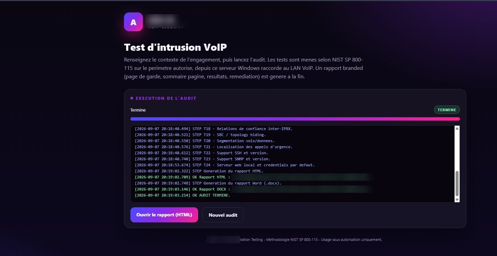
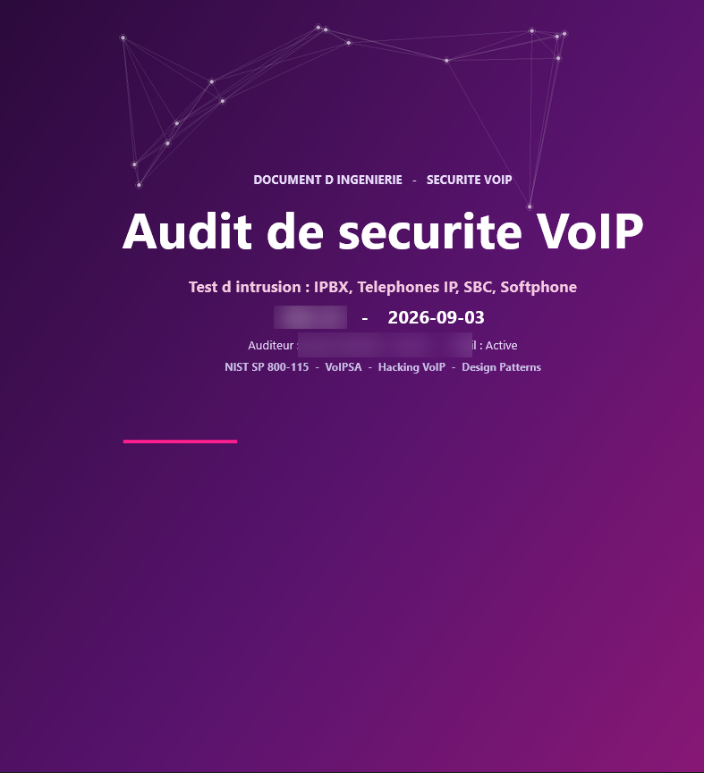


<a href="README.md">🌐 English</a> · <a href="README.fr.md">Français</a> · <b>Español</b>

# 🛡️ Auditoría de seguridad VoIP — ASA AI

### Test de intrusión SIP/VoIP profesional — NIST SP 800-115

**Encuentre los fallos de su infraestructura de voz — antes que los atacantes.**

---

## Su VoIP está expuesta hasta que se audita

PBX, trunks SIP, teléfonos IP, SBC y softphones amplían su superficie de ataque. Malas configuraciones, contraseñas por defecto, segmentación débil y fugas de topología convierten su plataforma de voz en una puerta de entrada — escucha, fraude, movimiento lateral en su red.

## Metodología — NIST SP 800-115

Las auditorías siguen el marco **NIST SP 800-115** (complementado con VoIPSA), ejecutadas **solo sobre el perímetro autorizado**, desde un servidor conectado a la LAN VoIP. **Pruebas no destructivas, solo bajo autorización.**

## Qué probamos

- **Objetivos:** IP-PBX / Asterisk, teléfonos IP, SBC, softphones
- **Protocolos y servicios:** SIP, SSH, SNMP (soporte y versiones)
- **Controles de seguridad:** relaciones de confianza inter-IPBX, SBC / topology hiding, segmentación voz/datos, enrutamiento de llamadas de emergencia, credenciales web por defecto — y más.

## Qué recibe — un informe branded

Un informe de ingeniería profesional: **portada premium, índice paginado, resultados y remediación** — entregado en **Word (.docx) y HTML**.

## ¿Para quién?

- **Empresas** con PBX / trunks SIP.
- **Operadores e integradores VoIP** que protegen plataformas de clientes.
- **MSSP / SOC** que añaden una línea de seguridad de voz.

---

## 🚀 Solicite una auditoría o un presupuesto

### 📩 **contact@asa-ai.fr** · 🌐 **[asa-ai.fr](https://www.asa-ai.fr)**

---

## Acerca de ASA AI

**ASA AI** desarrolla soluciones de **seguridad VoIP** y **automatización del SOC** impulsadas por IA.

🌐 [asa-ai.fr](https://www.asa-ai.fr) · 📩 [contact@asa-ai.fr](mailto:contact@asa-ai.fr) · 💼 [LinkedIn](https://www.linkedin.com/in/asa-ai-101815430/)

Uso solo bajo autorización · © ASA AI · Isla de Francia, Francia
